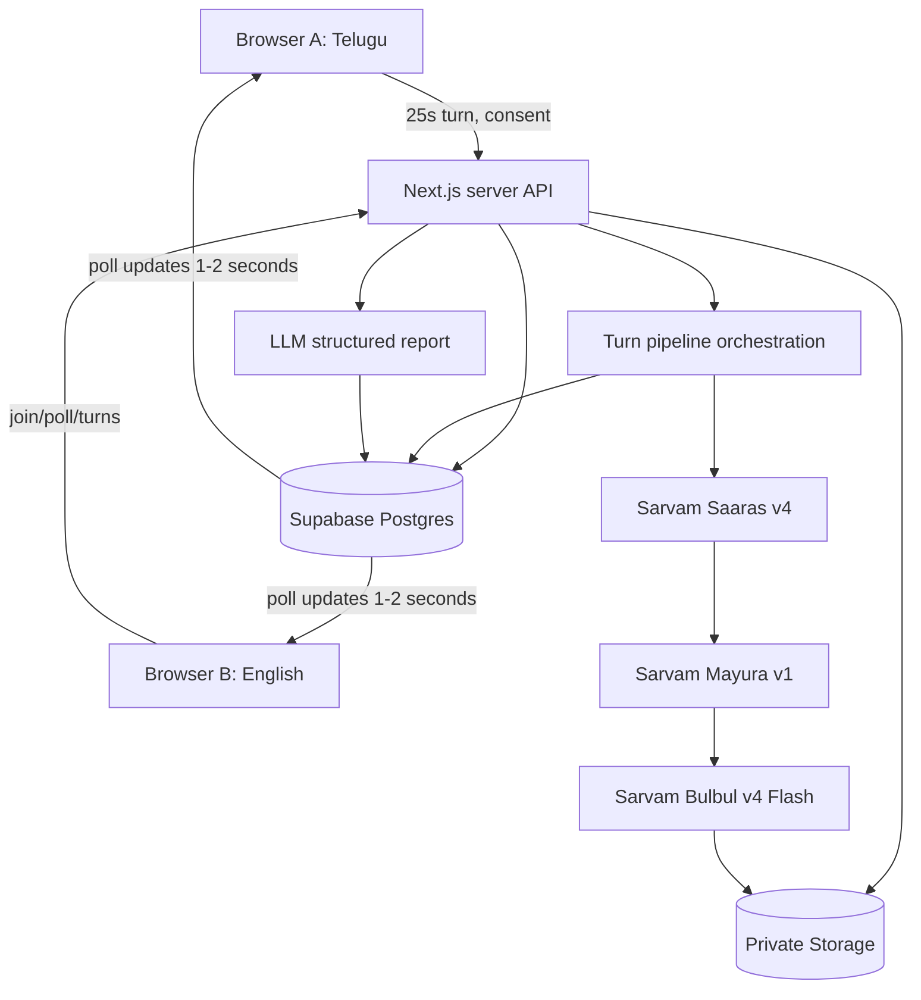
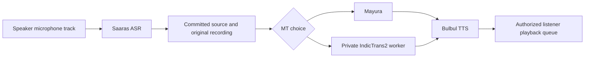

# Approach and Technical Architecture

## Running system and directional experiment

Next.js serves React, authenticated room HTTP routes and the server-side provider relay in one Node process. Room state uses PostgreSQL and private Supabase buckets in production, with PGlite and private files for local development. The AudioWorklet emits 16 kHz mono PCM every 200 ms. Local energy detection keeps a short onset buffer, a room lease selects one speaker, and the relay opens one Saaras WebSocket per phrase. The browser polls the timeline, including draft Mayura text. A provider final or manual finish archives the original WAV. Durable translation and Bulbul synthesis precede ordered playback. OpenAI reads finalized evidence for the canonical report and localization. ADR-0004 governs the live path.

| Experimental direction | Capture and processing | Destination |
| --- | --- | --- |
| A → B | A microphone, A stream generation and sequence, A source-language ASR, stable segments translated to B's listening language | B's translated-audio queue |
| B → A | B microphone, B stream generation and sequence, B source-language ASR, stable segments translated to A's listening language | A's translated-audio queue |

Keep each original track separate from rendered audio. Share only approved terminology and finalized room context. Revisions may replace visible draft captions. Commit a stable clause with enough context for target word order before synthesis. Link each commit and ordered audio segment back to one attributed original. With bounded queues, surface backlog, preserve original evidence and offer phrase fallback. Headphone interruption cancels pending playback with replay available. Speakerphone suppresses capture during output. On reconnect invalidate the previous generation, reject late frames, reconcile archived turns and require microphone activation. Benchmark overlap, packet loss and lag separately before switching transport or lifting the production lease. Independent channels alone do not establish simultaneous interpretation.

## Crucial architectural choice
Sahva P0 is a **synchronous-feeling, turn-based voice room** built from short recorded utterances. It is *not* a continuously streaming, two-way audio track. This is deliberate: for a 12-hour build, making the entire record/translate/playback/report loop reliable matters more than low-latency simultaneous interpretation. See ADR-0001.

## P0 architecture (preferred)



## P0 transports and delivery
- **No LiveKit dependency is required** to deliver the turn-based room. Two browsers join through server-issued participant tokens; state and recordings are persisted in Supabase; browser polls `GET /api/rooms/:id/timeline` every 1–2 seconds (easy to debug/deploy). Polling is a performance compromise, not simultaneous streaming.
- A room token is signed on the server, scoped to one room and participant, and expires. Never use a mere numeric room ID for authorization.
- Optional Supabase Realtime for turn updates only after core behavior works. A managed LiveKit room is a P2 step for truly open-mic, full-duplex voice. Do **not** install it out of habit; that adds tokens, track routing, noise, echo and permission issues today.
- Long-running provider work: initiate one request after upload; on a platform with short serverless time limits, use Supabase Edge Functions or an appropriate queued worker. Avoid fire-and-forget promises from an ephemeral handler. Validate end-to-end worker execution in the selected deployment before starting the main build.

## Core modules (deep and independently testable)
1. `RoomService`: create, join, authorize, consent, presence, end; owns room invariants.
2. `TurnService`: validate clip/participant, store source, enforce duration and idempotency, manage state.
3. `SpeechPipeline`: ASR → translation by target language → TTS and persistence, retries and stage timings. All vendor calls behind interfaces.
4. `TimelineProjection`: join turns, source transcript/revisions and recipient deliveries into one permissioned view.
5. `MeetingIntelligence`: typed extraction of canonical facts with source turn IDs and conservative certainty statuses; rejects unsupported claims.
6. `ReportLocalization`: translates only human-language prose, never IDs, statuses, owner keys, dates or evidence relationships.
7. `AudioAccessService`: private object keys, authorized signed download URLs, purge.

## Provider ports
`Transcribe(audio,keyterms?) -> {text,language,providerRequestId}`  
`Translate(text,sourceLanguage,targetLanguage,context?) -> {text,providerRequestId}`  
`Synthesize(text,language,voice) -> {audioBytes,mimeType,providerRequestId}`  
`ExtractMeetingRecord(turns,meetingMetadata) -> CanonicalMeetingRecord`  
`LocalizeMeetingRecord(canonical,language) -> LocalizedProjection`.

Explicit versioned types and validators prevent leaking external provider response shapes into React components or domain models. Test with stubs.

## One-turn processing order
1. Client obtains microphone consent and records local clip with visible timer.
2. Client submits blob and `idempotencyKey`. Server validates membership, MIME/duration/size, room status and consent.
3. Save original audio to private storage and create `turn` row `uploaded` before invoking external models.
4. Run ASR; save raw output `source_transcript` and recognized language. Errors are stage-specific.
5. For each unique other-party preferred language, translate (or bypass if same language).
6. Run TTS for translated text; decode base64 response to audio bytes; persist private media object.
7. Update delivery status; polling client sees result and signed playback URLs. No unconditional autoplay assumption.
8. On speaker correction, store a new revision, invalidate affected translations/report, re-run only dependent stages; never erase original audio.

## Report flow
1. Room ends; gather all ready turns and latest approved revisions, keeping original ASR and turn IDs separately.
2. LLM returns schema-validated JSON with summary; `decisions`, `actions`, `unresolvedQuestions`; exact source `turnId` arrays; canonical event status.
3. Post-validator rejects evidence IDs not in the room and items with an owner/date unsupported by available statements (automated semantic enforcement is imperfect; require conservative prompts and manual review for high-stakes terms).
4. Persist canonical record exactly once, with generation version and source revision hashes.
5. Render English or Telugu translations as separate projections; keep entity IDs and structured fields identical.

## Security and error boundaries
- Browser → server: session cookie/room token, validated server-side. Keys never exposed.
- Server → Sarvam/LLM: keys injected via environment; bounded request size and timeout.
- Server → Storage: service identity; browser only receives short-lived signed URLs for objects associated with its room.
- Persist stage failure type and retry count; retry only idempotent operations, backoff on 429/5xx. No infinite retries.
- Separate room join from consent; participant list and recording disclosure always visible.

## Explicitly rejected alternatives for P0
| Alternative | Why rejected today | Revisit |
|---|---|---|
| Full LiveKit WebRTC audio calling + track translation | Highest risk of raw/translated overlap and routing | After turn pipeline is stable |
| OpenAI realtime translation only | Telugu translated speech output coverage not guaranteed for our target; needs verification | Later provider comparison |
| WhatsApp group bot | Account eligibility and messaging permissions can block demo | Post-event |
| Pure client→provider calls | Leaks API key and weakens authorization/storage control | Never |
| Entire transcript as direct context | No provenance, invented agreements and context window growth | Never without typed evidence extraction |
| Separate report generation per language | Divergent 'facts' between participants | Never |
| Overengineered queue + microservices | Time cost without demo value | Scale phase |

## Suggested repo skeleton
```
sahva/
  app/                  # Next.js routes, pages, React UI
  app/api/              # server endpoints, auth and handlers
  components/room/      # room controls, audio cards, report
  lib/domain/           # schemas, room/turn/report invariants
  lib/providers/        # sarvam adapters, LLM adapter
  lib/server/           # auth, storage, repositories, orchestration
  lib/shared/           # API DTOs and language constants
  supabase/migrations/  # versioned SQL, RLS if client access is used
  tests/                # contract and end-to-end smoke tests
  fixtures/             # consented synthetic/test audio only
  docs/                 # these docs; do not duplicate sources
  AGENTS.md
  PROJECT_SUMMARY.md
```

## Implemented runtime

The EC2 deployment, local persistence option and audio duration verification follow [ADR-0003](adr/0003_github_to_ec2.md). Production uses a private PostgreSQL schema and a single canonical JSONB meeting record with an immutable-by-version projection of Telugu display strings. Each source citation carries the turn and its transcript revision. Discrete awaited requests claim one speech stage at a time. Polling clients can continue an abandoned lease. An ended room remains available for playback and speaker corrections until access expiry.

## Live phrase mode

The expanded local demo adds a short-lived Sarvam PCM WebSocket, draft captions and phrase-boundary delivery alongside the recorded-turn route. It uses the same single-process room server, recording lease, storage and canonical report. [Accepted live interpreter decision](adr/0004_live_interpreter.md)

## Deployed meeting audio and proposed direct interpretation

Group rooms on release `c7011ab` use LiveKit Cloud. The hidden server subscriber passes each microphone to `interpretTrack` in `lib/server/meeting.ts` with its authenticated participant identity. Each reader supplies 16 kHz mono PCM in 100 ms frames. On voice activity the bridge opens a speaker-scoped Sarvam stream with up to four buffered frames. Saaras supplies changing captions, Mayura produces drafts, and `finishLive` archives the source WAV. The turn processor translates finalized text and requests Bulbul audio. Each listener's timeline selects the appropriate delivery or original. Consent withdrawal stops the bridge and rotates the media epoch. [Group meeting decision](adr/0005_livekit_meetings.md)

| Path | Earliest possible translated playback | Work the application owns |
| --- | --- | --- |
| Deployed Sarvam | After phrase finalization, translation, synthesis and delivery | Separate ASR, translation and voice calls, per-speaker voice selection, original and revision history |
| Proposed Gemini | When the first intelligible translated PCM reaches a listener's playback queue | One directional stream per speaker and distinct target, ordered listener playback, interruption, archival alignment and session renewal |

“Direct” describes the application interface. Google's internal representations are unspecified. The first comparison runs outside the room on identical source PCM. A later opt-in bridge could fork each authorized microphone reader into archive and translation paths. Progressive playback would need a listener-scoped channel because the existing worker can only subscribe and the timeline serves finalized files. Same-language listeners continue to use the original. [Experimental decision and adoption criteria](adr/0006_gemini_live_translate.md)

## Multi-provider evaluation

See [ADR-0007](adr/0007_translation_lab.md) for listener-scoped selection, media authorization, archive provenance and fallback. Source and spoken target coverage are separate predicates. Existing participant storage accepts English and Telugu. Additional languages start in the recording lab until the complete meeting contract supports their archives, delivery, voice selection and reports.


## Experimental translation stage



Initially replay text outside meetings. A later test room scopes each job to speaker, phrase revision, target, voice and consent epoch. Reject stale output after cancellation, order delivery per listener, and archive committed turns for report evidence. Identical targets may share text. Drafts remain provisional. A benchmark records a failed engine explicitly. [ADR-0008](adr/0008_self_hosted_translation_eval.md)
