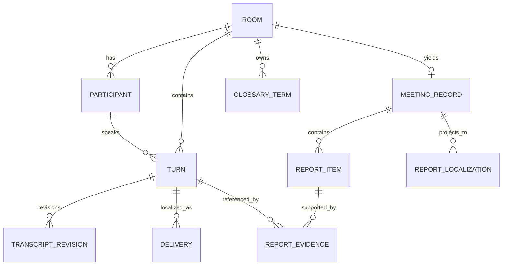

# Domain and Data Model

This is a **logical schema proposal**, not proof of migrated database tables. Start with the smallest executable migrations and extend via ADRs. The service layer, not UI state, owns validation and authorization.

## Core entities and relationships



## Proposed tables (P0 first)

### `rooms`
`id uuid PK`, `title text`, `invite_token_hash text`, `owner_participant_id uuid nullable`, `status enum(created,active,ending,ended,summarizing,summarized,summary_failed,expired)`, `created_at timestamptz`, `ended_at timestamptz?`, `expires_at timestamptz`, `time_zone text default 'Asia/Kolkata'`, `consent_copy_version text`, `deleted_at timestamptz?`.

**Invariant:** only two active participants in P0; `ending/ended` room cannot accept new turns. Invite token hash, never the full secret, in DB. Expiry checked on every route.

### `participants`
`id uuid PK`, `room_id uuid FK`, `display_name text`, `listening_language enum(en-IN,te-IN)`, `join_token_hash text`, `joined_at timestamptz`, `last_seen_at timestamptz`, `consented_at timestamptz?`, `consent_version text?`, `is_owner bool`. Enforce unique `(room_id,id)` and up to two participants via serialized room-join transaction / database lock (not only React validation).

### `turns`
`id uuid PK`, `room_id uuid FK`, `speaker_id uuid FK`, `turn_seq int`, `original_storage_key text`, `original_mime text`, `duration_ms int`, `source_language_code text?`, `raw_source_transcript text?`, `status enum(uploaded,transcribing,transcribed,translating,ready,failed)`, `failed_stage enum(upload,stt,translation,tts)?`, `error_code text?`, `idempotency_key text`, `created_at timestamptz`, `completed_at timestamptz?`, `retry_count int`, `provider_request_ids jsonb?`. Unique `(room_id,speaker_id,idempotency_key)` and `(room_id,turn_seq)`.

**Invariant:** original storage key never changes after accepted upload. A 'ready' source turn may still have one failed recipient delivery; prefer delivery-level status rather than hiding the turn.

### `transcript_revisions`
`id uuid PK`, `turn_id uuid FK`, `revision_num int`, `text text`, `edited_by_participant_id uuid FK`, `edited_at timestamptz`, `reason text?`, `is_current bool`. Raw transcript stays on `turns`. Store current as a single pointer or enforce unique `is_current` with a partial index.

### `deliveries`
`id uuid PK`, `turn_id uuid FK`, `target_language_code text`, `translation_text text?`, `tts_storage_key text?`, `tts_mime text?`, `status enum(pending,translating,tts_generating,ready,failed)`, `failed_stage text?`, `source_revision_num int`, `provider_request_ids jsonb?`, `completed_at timestamptz?`. Unique `(turn_id,target_language_code,source_revision_num)` so multiple listeners of one language share outputs later.

### `meeting_records`
`id uuid PK`, `room_id uuid FK UNIQUE`, `version int`, `source_revision_fingerprint text`, `status enum(generating,ready,failed,stale)`, `summary text`, `created_at timestamptz`, `generated_by_model text?`, `validation_errors jsonb?`.

### `report_items`
`id uuid PK`, `record_id uuid FK`, `kind enum(decision,action,question)`, `description text`, `status enum(agreed,proposed,unresolved)`, `owner_participant_id uuid?`, `owner_free_text text?`, `due_date date?`, `due_date_precision enum(exact,relative,unknown)?`, `needs_confirmation bool`, `created_at timestamptz`. Do not confuse `owner` with the speaker — the speaker may be assigning another person, which must be explicit.

### `report_evidence`
`item_id uuid FK`, `turn_id uuid FK`, `transcript_revision_num int`, `quoted_span text?`. PK `(item_id,turn_id,transcript_revision_num)`. Server verifies turn belongs to same room and quote exists in source revision before persisting if possible; semantic accuracy still requires review.

### `report_localizations`
`id uuid PK`, `record_id uuid FK`, `language_code text`, `record_version int`, `localized_json jsonb`, `created_at timestamptz`; unique `(record_id,record_version,language_code)`. Localizations cannot override source ID, participant ID, due date, status, evidence links or canonical item count.

### `glossary_terms` (P1)
`id uuid PK`, `room_id uuid FK`, `preferred_text text`, `language_code text?`, `meaning text?`, `pronunciation text?`, `suggested_by uuid FK`, `approved_by uuid?`, `status enum(suggested,approved,rejected)`, `created_at timestamptz`, `updated_at timestamptz`. Limit ASR keyterms to vendor max 50/64 chars.

## Canonical meeting record JSON shape
```json
{
  "schemaVersion": "1",
  "roomId": "uuid",
  "summary": "Two participants discussed dispatch of 20 cartons.",
  "decisions": [{"id":"uuid","text":"Monday dispatch accepted","status":"agreed","evidenceTurnIds":["turn-uuid-a","turn-uuid-b"]}],
  "actions": [{"id":"uuid","text":"Dispatch 20 cartons","ownerParticipantId":"participant-uuid","dueDate":null,"status":"proposed","evidenceTurnIds":["turn-uuid-a"]}],
  "openQuestions": [{"id":"uuid","text":"What pickup time?","status":"unresolved","evidenceTurnIds":["turn-uuid-b"]}]
}
```
*Illustrative ID placeholders only: production validators require actual UUIDs and IDs in the same room.*

## Localization invariants
Compare canonical and Telugu/English projections: item IDs, counts, status, dates, owner references and evidence must be byte-identical. Translated prose may differ. Preserve language-neutral meaning and prohibit AI from adding new items during localization.

## Storage
Private buckets: `room-original-audio` and `room-translated-audio`. Example keys: `rooms/{roomId}/turns/{turnId}/original.webm`, `rooms/{roomId}/turns/{turnId}/translated/{language}/{revision}.wav`. Client does not choose arbitrary object paths. All reads use short-lived, scoped signed URLs issued by server after room authorization.

## Retention and deletion
For buildathon prototype, choose a documented short retention window (proposal: 24h after room end) **only if a tested deletion job exists**. Until then, explicitly label manual deletion and use a monitored operator checklist; do not claim auto-expiry simply because an `expires_at` column exists. Purge DB rows, original and generated objects, revisions, glossary and report. Provider retention is governed by vendor terms and must be disclosed separately.

## Transaction and isolation strategy
Use server-only Supabase service role and authorize all queries by participant-room token. Never expose direct public table selects with service role. Optional RLS if client database access introduced; migration tests required. For concurrent joins/turns, enforce limits in database transactions and unique indexes rather than memory flags.
