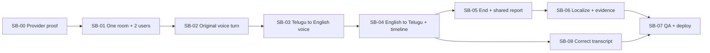

# Work breakdown and release plan

## Current milestone after the public MVP

The continuation brief calls continuous two-channel translation **Phase 4**. Its engineering ticket here is **P3 STREAM-01**. The phase numbers in the historical buildathon and live-demo tables describe different milestones.

The public two-person baseline is 41c5cf7. A real-provider synthetic call passed on its public HTTPS endpoint. The real phone and laptop acceptance gate remains open. Voice selection and a same-recording, two-direction provider comparison have local evidence. The three-profile LiveKit Cloud fixture verified room-scoped audio, overlapping speakers, listener-specific delivery, original replay, consent revocation and evidence-linked reports. The same three-profile test passed against the public Oregon release c7011ab on 21 November 2026. Physical-device testing remains open.

STREAM-01 adds a feature-flagged LiveKit meeting beside the existing room. Admit participants with room-scoped credentials and speaking/listening preferences. Prove two independent microphone tracks, then use a third participant with a different listening preference to verify personalized delivery. On the right, show an attributed bubble while each person speaks and finalize that same message with its original media and transcript. Measure caption onset and audible translated playback against the public baseline. Exercise overlap, withdrawal, reconnect and evidence-linked reports before rollout.

## Active release sequence

| Priority / ticket | Depends on | Expected behavior and acceptance | Validation | Status / primary risk |
| --- | --- | --- | --- | --- |
| P0 LIVE-03 | LIVE-02 | Two people alternate hands-free, see captions, hear the right translation and review the same supported outcomes. Measure both directions. | Follow the physical rehearsal in the QA playbook with headphones and speakers. Log the first failing stage and rerun the affected phrase. | In progress. Laptop translation was acceptable to the speaker. Verify the new message layout and physical audio. |
| P1 SB-07-AWS | LIVE-03, authorized Oregon host and project | Commit-tagged single Node process serves trusted HTTPS with scoped private media, reconnect and bilingual reports. | Follow AWS runbook, record deployed SHA, readiness, negative access check and remote two-device smoke. | Public HTTPS passed four two-person turns on 41c5cf7 and a three-person group call on c7011ab. Physical acceptance pending. |
| P2 VOICE-01 | Stable phrase path | Speaker can select a supported voice and change future turns. Existing audio and reports remain replayable. | Check both directions, retry, reload, and paired listening for questions/emphasis and names. | Voice selection and previews verified locally. Released in c7011ab. Bilingual listening review pending. |
| P3 STREAM-01 | Measured phrase baseline | Isolated trial with two independent directions, bounded ordered playback and stable text commitments. | Same clips on baseline and trial. Record overlap, revisions, latency, entity errors, intelligibility, cost and fallback. | Isolated two-direction comparison completed locally. Three-profile Cloud integration passed locally and on sahva.madsoul.in with c7011ab. Physical acceptance remains open. |
| P4 DEMO-01 | Physical and public gates, any enabled experiment qualified | Two devices, fresh utterance, canonical report, identical-recording baseline comparison, tested backup. | Bilingual reviewer signs off on differences or ties and known limits. Decode backup and rehearse recovery. | Open. Existing private synthetic backup covers LIVE-02. |

### Direct speech translation experiment

| Ticket | Dependency | Acceptance evidence |
| --- | --- | --- |
| S2ST-01 Access | Phase 4 handoff | Verify exact model, credential route, setup acknowledgement, quotas or a sanitized failure. |
| S2ST-02 Single speaker | S2ST-01 | In each direction, stream paced source PCM, capture both transcript streams and play translated PCM as it arrives. Keep original, timestamps and playback evidence. |
| S2ST-03 Two channels | Both directions pass | Run two independent simultaneous sessions. Check overlap, queue ownership, interruption, disconnect and teardown. |
| S2ST-04 Comparison | Single-speaker evidence, S2ST-03 for overlap | Match fixture hashes, compare actual Sarvam and Gemini timings per direction, annotate quality and cost, record missing observations. Blind bilingual review includes high-risk details and expression. |
| S2ST-05 Room trial | Documented advantage under ADR-0006 | Explicit server-side opt-in on a test room, independently scoped playback, Sarvam fallback. Verify mute, rejoin, consent epoch, original replay, caption attribution, voice preference, localized reports and evidence on three clients, then physical devices. |
| S2ST-06 Adoption decision | S2ST-05 | Record measured tradeoffs and explicit release decision. A failed gate retains the deployed engine. |

**21 November result.** S2ST-01 verified authenticated streaming and two-session capacity on this project. S2ST-02 and the isolated concurrent playback path in S2ST-03 passed using synthetic audio. Physical acoustics and transparent reconnection remain open. S2ST-04 measured a latency gain and material meaning errors. S2ST-05 is on hold. Retain Sarvam for this release under S2ST-06. [Paired results and evidence](../qa/S2ST_BENCHMARK.md)

Historical foundation tickets and original timing assumptions follow.

**Method:** Matt Pocock-style vertical tracer bullets: each ticket should leave a feature demonstrable through UI/API/storage rather than deliver a standalone layer. This local file is the single ticket tracker until migrated to real issues. Update status **here**, but record factual completion evidence and handoff in `PROJECT_SUMMARY.md`.

## Implementation checkpoints — 2026-11-21

| Ticket | Observed state |
| --- | --- |
| SB-00 | Both directions returned decoded audio from Sarvam with supplied recordings. Native-speaker quality review pending. |
| SB-01 | Two isolated Chrome sessions verified locally, including third-seat denial and withdrawal. |
| SB-02 | Private original replay after refresh and provider failure verified locally. |
| SB-03/04 | Four consented recordings through both directions with two Chrome sessions. Two physical devices pending. |
| SB-05/06 | Live canonical extraction and matched Telugu display tested on four source transcripts. See phase ledger for latest browser gate. |
| SB-08 | Live speaker revision reprocessed with original ASR preserved. |
| SB-07 | GitHub → existing EC2 release workflow under verification. Consult the latest ledger entry for deployment state. |

The ticket descriptions below preserve baseline dependencies and original estimates.

## Dependencies

## Tickets

### SB-00 — Provider and environment proof | H0–1 | P0 | Status: TODO | Blocks all
**Build:** Local/HTTPS server-only smoke endpoint or script exercises real Sarvam STT, Mayura and Bulbul for both directions. Check actual environment credential injection, media codec and latency.  
**Demo/test:** Play 2 real translations with 2 original source clips; note rate/limit errors and provider request IDs.  
**Done:** Test evidence in phase log; choice of recorder MIME and voices confirmed. No provider failure silently ignored.

### SB-01 — Two users in one consented room | H1–2.5 | P0 | Blocked by SB-00
**Build:** Room create, invite join, authorized owner/guest, per-user language, consent display, room 2-seat enforcement, presence polling.  
**Demo/test:** Two browser profiles can join; a third receives room-full message; no recording before consent.  
**Done:** Persistence across refresh and valid authorization checks.

### SB-02 — One original audio turn, saved and replayable | H2.5–4 | P0 | Blocked by SB-01
**Build:** 25s MediaRecorder flow, upload endpoint, idempotency, private storage, time-sequenced timeline card, source audio replay.  
**Demo/test:** Speak once on A, replay the original on B after refresh; no duplication on retry.  
**Done:** Source remains available after failed downstream processing.

### SB-03 — Telugu→English processing | H4–5.5 | P0 | Blocked by SB-02
**Build:** ASR→MT→TTS adapters, secure background/awaited orchestration, status feedback, per-stage errors.  
**Demo/test:** A speaks Telugu, B sees English text and plays synthesized English voice.  
**Done:** Real API integration, real audio, not a canned response.

### SB-04 — Bidirectional and durable shared conversation | H5.5–7 | P0 | Blocked by SB-03
**Build:** Reverse English→Telugu, alternate turns, timeline polling, source and translation controls, hide/show transcript, playback state.  
**Demo/test:** Four fresh turns across two devices, source+translation accessible.  
**Done:** No raw/translated overlapping microphone stream or stuck auto-play.

### SB-05 — Canonical report from conversation | H7–8.5 | P0 | Blocked by SB-04
**Build:** End room, schema-constrained LLM extraction, summary/decisions/actions/unresolved, status and evidence ID validation, report persistence.  
**Demo/test:** End a real call; reports propose no unsupported owner/date and include evidence-linked action.  
**Done:** Report idempotent; AI errors don't fabricate commitments.

### SB-06 — Localized report and evidence jump | H8.5–9.5 | P0 | Blocked by SB-05
**Build:** Render English/Telugu versions of same canonical record. Source action ID/citation jumps to original turn.  
**Demo/test:** Switch language without changing IDs/status/owners/dates; click action to view source.  
**Done:** Comparison script checks projection invariants.

### SB-08 — Transcript revision (small slice) | H9.5–10.25 | P0 | Blocked by SB-04
**Build:** Revision form, history, dependent output invalidation/reprocess with concurrency guard.  
**Demo/test:** Fix product name, see new translation, original ASR/audio preserved.  
**Done:** No silent destructive overwrite. If squeezed, preserve correction and disable auto-reprocess with visible notice; record incomplete AC-15.

### SB-07 — QA, deployed proof and pitch | H10.25–12 | P0 | Blocked by SB-06 (and SB-08 if accepted)
**Build:** Browser/device matrix, adversarial fixtures, visual cleanup, provider cost guard, HTTPS deploy, 3-minute demo video.  
**Demo/test:** Fresh two-device Telugu/English conversation, end, report and source evidence; real latency observed.  
**Done:** Release gate sheet checked with evidence; limitations declared.

## P1 extension tickets (DO NOT START until P0 gates pass)
- SB-09: glossary term approval → ASR v4 `keyterms` → improved future turn.
- SB-10: item confirmation/rejection → status transitions with participant sign-off.
- SB-11: transparent same-recording baseline/system evaluation screen, with source-audio fixtures and human truth labels.
- SB-12: copy/export localized Markdown meeting notes.

## Time protection and priority cuts
At H4, if room upload is not working, **stop building summary UI**. At H7, if reverse translation is not working, concentrate on it. At H9.5, if report needs work, cut glossary and export, not evidence. At H11, freeze features and test/deploy. If recorder or vendor fails irrecoverably, fallback to voice-note upload in a room with translation+report and truthfully describe this reduced scope.

## Definition of done per ticket
- Functional behavior demonstrated at the highest reasonable seam.
- Test(s) added for domain invariants; typecheck/lint where configured.
- Errors/states/unauthorized path exercised.
- Real external dependency smoke-tested when applicable.
- Existing diff inspected; only ticket-related changes.
- `PROJECT_SUMMARY.md` appended with exact artifacts, tests, defects and next step.

## Update protocol
Change status here from `TODO` to `IN_PROGRESS` / `DONE` / `BLOCKED` only with associated phase-log evidence. Never mark deployed/QA complete based on code presence alone. If ticket boundaries change, record an ADR/decision and update dependencies.

## Next buildathon demonstration

After the original SB-00–08 foundation, LIVE-01 covers live source captions, draft translation and automatic phrase delivery. LIVE-02 covers hands-free conversation and interruptions. LIVE-03 covers physical-device acceptance and judge rehearsal. See [live delivery phases](14_LIVE_DEMO_PHASES.md).

LIVE-02 passed the four-phrase local provider test. LIVE-03 hardware and hosted HTTPS checks are open. VOICE-01 follows with optional per-speaker voice previews, delivery preferences and fluent-listener evaluation of emotional expression and tone.

## Direction-specific model evaluation

| Phase | Dependency and acceptance |
| --- | --- |
| M0 | Inventory deployed routes, provider documentation and working tree. Record ADR-0007. |
| M1 | Gate the lab server-side. Filter source and spoken target separately. Unsupported preferences are never silently changed. |
| M2 | Verify OpenAI session setup, real audio, transcripts and graceful drain on Telugu → English and Hindi/English. |
| M3 | Verify a region-bound Qwen workspace and voice consent; run Hindi/English. |
| M4 | Reuse Sarvam and Gemini. Verify track ownership, listener routing, switching and consent cleanup. |
| M5 | Add Azure or ElevenLabs after region or enterprise eligibility and spoken language coverage are known. |
| M6 | Replay identical consented files, store model and timing evidence, collect independent human grades. |
| M7 | Run unit, browser and group regressions. Require separate approval for a deployment. |

## Self-hosted evaluation tickets

| Order | Ticket | Proof required |
| --- | --- | --- |
| A | GPU-00 / LAB-01 | Reconcile live implementation, exact fixture replay, bidirectional Sarvam baseline and speaker-confirmed references |
| B | GPU-01 / GPU-02 / LAB-02 | Approved time-boxed host, pinned MT workers, identical verified text and blinded critical-slot review |
| C | LAB-04 | Extend existing loopback lab with eligible stage choices and paired receipts |
| D | GPU-05 / LAB-03 | Independent Maya/Bulbul listening and concurrency trial after MT evidence |
| E | GPU-07 / GPU-08 / GPU-12 | ASR only after error attribution, heavier MT only after rights review |
| F | GPU-03 / GPU-04 / GPU-06 / GPU-09 | Qualified stage in a flagged room, ordered playback and evidence regressions |
| G | GPU-10 / GPU-11 | Cost, capacity, privacy and explicit release decision |

Ticket descriptions and operator steps are in the [research pack](Sahva_SelfHosted_Translation_Pack/docs/07_WBS_PHASE_PLAN.md).
