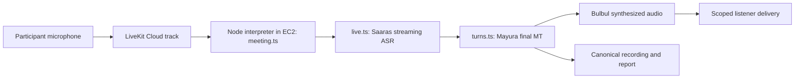
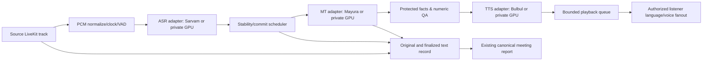
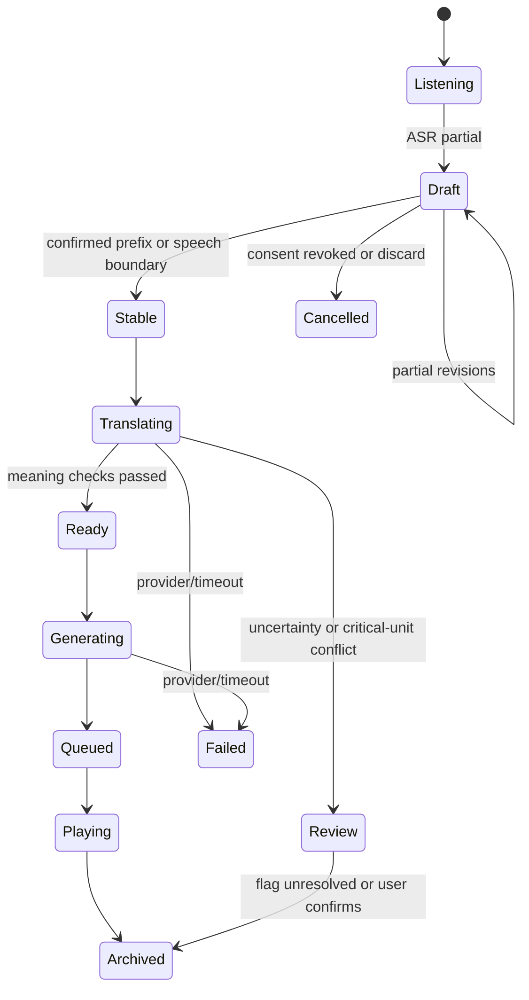
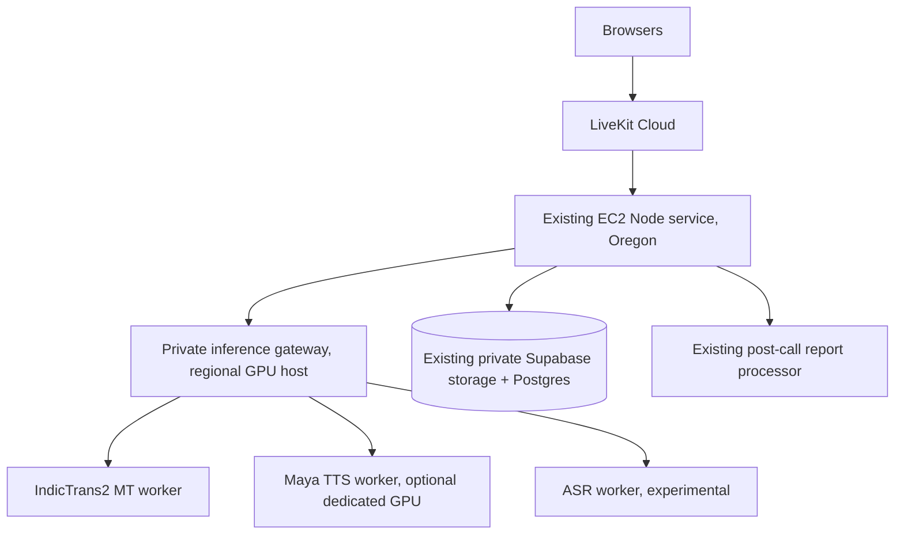

# 03 — Sahva Interpreter Runtime: architecture

## Current architecture (inspected GitHub snapshot)

This is not a blanket recommendation to replace LiveKit, the EC2 Node service, storage, consent, rooms, or reports.

## Target: pluggable *stages*, not monolithic models

A **private GPU service** hosts one or more models. The EC2 Node API is the *trusted orchestrator*, translating LiveKit frames into contracts and distributing outputs. The public browser never calls GPU workers directly or receives inference credentials.

## Transport and stream details
- Keep per speaker track independent; LiveKit remains source of participant identity. Normalize to mono 16-kHz s16le for ASR, with sequence, timestamps, source language and room-scoped permission checks.
- Input arrives in 100-ms LiveKit frames today. Aggregate only as needed, with bounded jitter and backpressure; avoid carrying large unbounded buffers or blocking track reader while TTS is queued.
- Use a **stable prefix** / segment commit policy. ASR partials may change; display them provisionally but do not send every partial to audio. Commit a phrase based on punctuation, confidence/hypothesis stability, pause and max-wait time. These are tuning values, not invariant 1.4-second hard turns.
- Append an explicit segment ID and original timestamp range. Once audio is **played**, it cannot be silently revised. If a late transcript correction materially changes meaning, show corrected text and a clear correction state; preserve audio and original transcript revisions.
- For MT context, provide small recent committed turns, participant glossary, and protected spans (numbers, product codes, amounts, names). Do not blindly translate a huge dialogue every time. Log missing contextual support per model.
- Fanout once per `(source segment, target language, MT engine)` when permitted; fan out TTS per `(translated segment, target language, voice, synthesis config)`. Do not broadcast confidential media to unconsented listeners or cross-room.
- Use a **bounded queue per listener** with no overlapping TTS and clear status: `listening`, `caption provisional`, `translating`, `voice queued`, `playing`, `catching up`, `failed`. Work out queue priority and interruption policy in experiments.

## Scheduling states

## Fact protection (do not silently hallucinate)
- Detect and tag candidate quantities, money/currencies, negative words, dates, addresses, proper nouns, IDs, and measurements; optionally use a deterministic preprocessor to carry opaque placeholders with reversible mapping.
- Verify protected fields survive MT; mismatch => flagged caption, source playback, or ask user to repeat, never an automatic authoritative rewrite.
- Code-mixed text needs explicit script strategy. Don't transliterate names into an incorrect form by default.
- A glossary is user-confirmed only; an interim transcript is **not** a verified term.

## Private GPU topology

**Phase 1**: deploy only MT to GPU, leave ASR and TTS on Sarvam. **Phase 2**: Maya TTS on the same GPU *only if measured memory and concurrency allow*; otherwise use another worker/host. **Phase 3**: ASR swap. Don't assume a 24GB card fits 15.9GB Bodhan MT + ~9.2GB Maya peak + CUDA/KV caches simultaneously.

## Lifecycle and failure recovery
- GPU worker health endpoint reports readiness **only after weights are loaded and a sample inference completed**. Liveness does not mean readiness.
- Connection setup: authenticated EC2 calls worker with request ID, source, target, engine version, deadline, consent/version metadata; worker never fetches arbitrary URLs.
- Every segment has idempotency key and stage-specific timeout. Retries use bounded exponential backoff for transient errors; do not retry the same audible segment after playback started.
- Cancel all room jobs on consent withdrawal; drop interim buffers, close private streams, invalidate pending playback; retain/delete existing records according to consent/retention rules.
- On GPU OOM/timeouts/driver crash, mark experimental engine failed and **offer explicitly labeled** Sarvam fallback. For fair benchmarks, record a failed experimental run; do not silently swap models and present it as that model's result.
- Preserve client room session and shared meeting intelligence if a stage fails. New turns route according to a safe policy at segment boundaries.

## Build strategy
- Create a new private service (Python FastAPI/gRPC/WebSocket only after deciding protocol from actual model runtime), separate GPU CI/container, deterministic model registry and dependency lock.
- Create thin Node adapters in `lib/providers` or preferred existing architecture; **do not refactor every Sarvam method immediately**.
- First tracer bullet: same WAV + source text → GPU IndicTrans2 → English/Telugu text + metrics → lab comparison, using the current saved WAV fixture and Sarvam ASR/TTS.
- Second bullet: valid authenticated live segment uses GPU MT behind a feature flag, creates the same existing delivery/turn schema, no new public DB changes unless justified.
- Only after functional acceptance connect full streaming pipeline.
